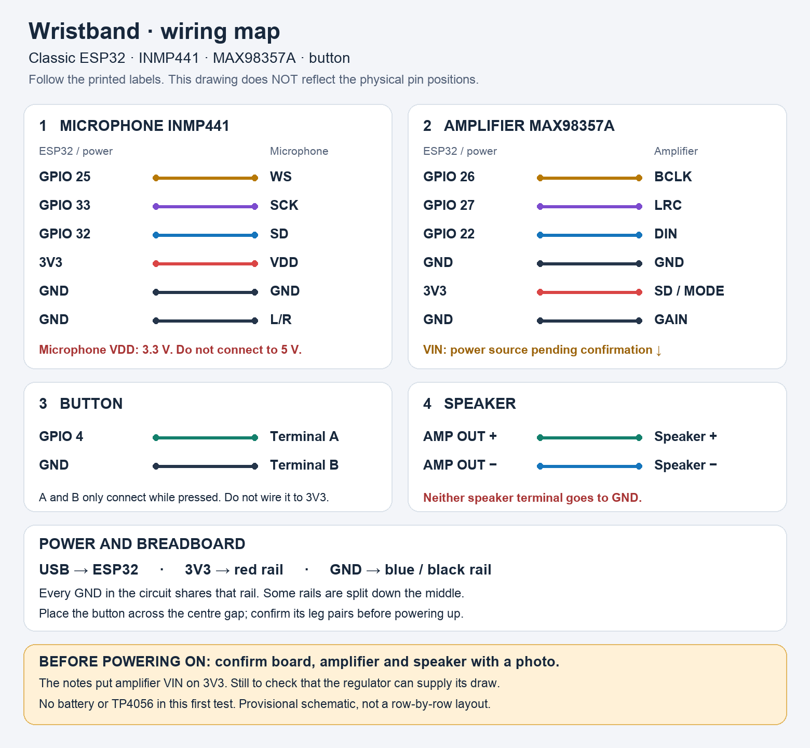

# Reference hardware

Confirmed goal: a voice wristband, no camera.

| Part | Recovered reference |
|---|---|
| Controller | ESP32; exact board pending |
| Microphone | INMP441 |
| Amplifier | MAX98357; physical variant pending |
| Speaker | Size, impedance and power pending |
| Power | Battery and TP4056 module; regulation, protection and capacity to be identified |
| Input | Button and switch |

## Pins used by both firmwares

- Button: GPIO4, active low with internal pull-up.
- Microphone: WS 25, SD 32, SCK 33; I2S0.
- Amplifier: BCLK 26, LRC 27, DIN 22; I2S1.

This map describes the recovered code, not a check of the physical build. The
power circuit still needs to be reconstructed and must not be inferred from
these signals.

The existing parts will be reused as a reference if they are still available. A
compact camera-less board, possibly an ESP32-S3 with PSRAM, will be evaluated
once the software is recovered. There is no shopping list and no final PCB yet.

## Visual map — 12 September 2026

Verified against the firmware GPIOs and the labels in the exported notes. It is
an electrical map by label, not a physical layout: the exact board and modules
still need to be identified from legible photographs before drawing breadboard
positions or rows. The amplifier VIN is pending: the notes say 3V3, but the
current allowed by the board regulator and the speaker impedance and power still
need validating. USB is proposed for the initial test, with no battery and no
TP4056.

SD on the INMP441 is a data signal and goes to GPIO32; SD/MODE on the MAX98357A
is select/enable and is shown at 3V3, as in the original note. Do not confuse
the two. L/R on the microphone tied to GND matches the configured left channel.
GAIN tied to GND preserves the historical configuration. All grounds are common;
there are no two separate grounds, whatever the old note might suggest.

The amplifier output is differential: both speaker wires go to OUT+/OUT−, and
neither goes to GND. The Adafruit reference module asks for a speaker of at
least 4 ohms. [MAX98357A reference pinouts](https://learn.adafruit.com/adafruit-max98357-i2s-class-d-mono-amp/pinouts).
The user's physical variant is still to be confirmed.

## Boards on hand — 16 October 2026

Two ESP32 boards, identified by the factory MAC read with esptool (the USB
serial number of the CP2102 bridge is a generic `0001`, so it cannot tell them
apart).

| Label | Chip | MAC | Flash | USB bridge | Result |
|---|---|---|---|---|---|
| A | ESP32-D0WDQ6 rev v1.0, dual core 240 MHz, Wi-Fi + BT | 34:86:5d:3f:b7:d4 | 4 MB | CP2102 | Detected and answers esptool |
| B | ESP32-D0WDQ6 rev v1.0, dual core 240 MHz, Wi-Fi + BT | 58:bf:25:a1:32:98 | 4 MB | CP2102 | Detected and answers esptool |
| C | ESP32-S3 (QFN56) rev v0.2, Wi-Fi + BLE, embedded 2 MB PSRAM | cc:ba:97:1d:4a:8c | 4 MB embedded | native USB-Serial/JTAG over USB-C | Detected and answers esptool |

Physical marking: A carries a sticker; B has none; C is the only one with USB-C.

Flash backups (full 4 MB, read with esptool at 115200 baud; 460800 and 921600
failed with serial noise on this cable) live in `../respaldos-flash/`, outside
this repo:

- B → `esp32-B-58bf25a13298-2026-10-16.bin`. Arduino-ESP32 build with I2S and
  Bluetooth A2DP ("Advanced Audio Sink") strings; no `/audio` route or server
  URL found, so it does not look like the recovered Leo firmware. Purpose
  unknown. Probably the `a2dp_sink.start("ESP32-Speaker")` Bluetooth speaker
  test from the Notion notes.
- C → `esp32-C-ccba971d4a8c-2026-10-16.bin` (921600 baud works over native
  USB). Arduino-ESP32 build with Wi-Fi and an HTTP server (ESPHTTPD); no camera
  or audio strings found. Purpose unknown.
- A → pending.

## Other parts on hand — 16 October 2026

Reported by the user, not yet tested:

- Speakers: two identical ones plus two of other types (sizes and impedance unknown).
- Amplifier MAX98357A (I2S, the one the firmware uses).
- Amplifier PAM8403 (class D, analog input, 2 channels). It does not speak I2S:
  it would need the classic ESP32 DAC (GPIO25/26) or a PWM output; the ESP32-S3
  has no DAC. Kept as a fallback, not on the main path.
- Microphone INMP441 (presumed; to be confirmed by its label).
- Lithium battery (capacity and protection unknown) and TP4056 charger module.
- Camera: ArduCAM / OV2640 according to the 2024 notes; model to be confirmed.

Bench tests run on USB power only; battery and TP4056 stay disconnected until
the voice path works.

## Bench results — 16 October 2026

1. Board B accepts uploads (115200 baud, hash verified). Sketch
   `firmware/bench/beep` starts I2S1 with `ESP_OK`.
2. MAX98357 + speaker (one of the two identical ones) on B, wired per the 2024
   notes (VIN 3V3, GAIN GND, SD 3V3, DIN 22, BCLK 26, LRC 27): the 440 Hz tone
   is heard. Amplifier and speaker work.
3. INMP441 on B, wired per the 2024 notes (VDD 3V3, GND, L/R GND, WS 25,
   SCK 33, SD 32), sketch `firmware/bench/mic_level`: 60 s capture, 10 readings
   per second. Quiet room floor about −62 to −65 dBFS (16-bit scale, TV playing
   in another room); voice and claps peak at −24 to −31 dBFS, 30–40 dB above
   the floor. The microphone works.
4. Button on B between GPIO4 and GND (internal pull-up), sketch
   `firmware/bench/button`: 4 presses detected, each PRESIONADO paired with
   SUELTO, no bounce seen. The button works.
5. Full path on B with `firmware/wristband` (protocol v2), server on the Mac
   over the home 2.4 GHz Wi-Fi (B and the Mac on the same LAN):
   two spoken questions with a TV in the background. Whisper heard both word
   for word ("¿Cuál es la capital de Francia?", "y la capital de Brasil"); the
   answers (2.8 s and 2.9 s of audio, ready 6.7 s and 3.4 s after the end of
   the upload) played correctly through the speaker. **First physical
   end-to-end run since 2024: the voice path works.**
