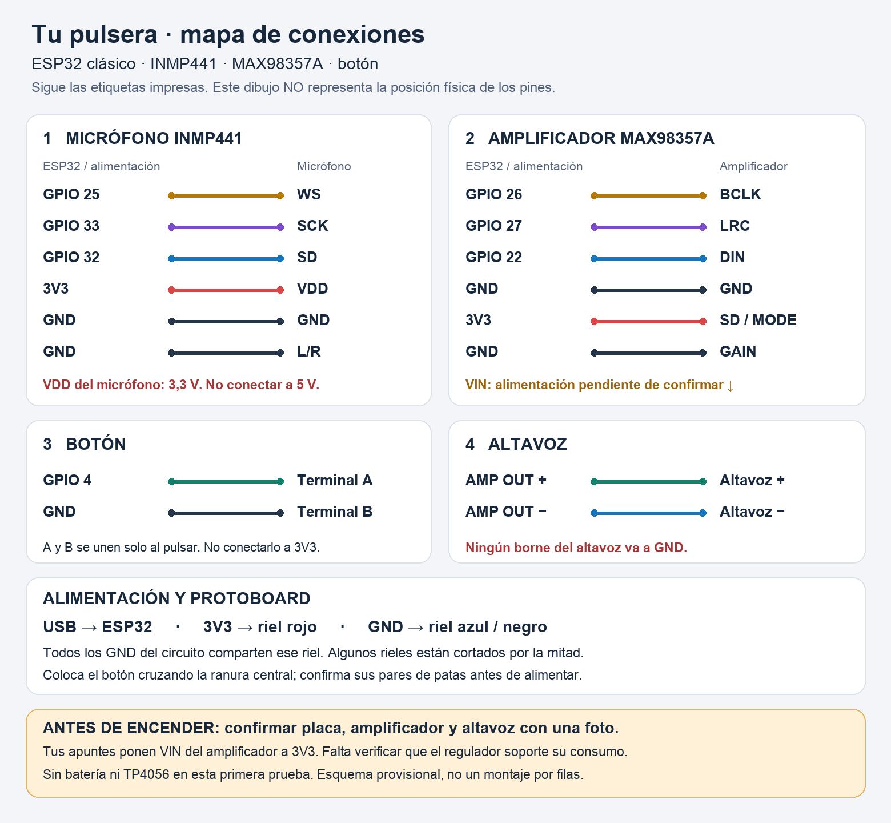

# Hardware de referencia

Objetivo confirmado: pulsera de voz, sin cámara.

| Parte | Referencia recuperada |
|---|---|
| Controlador | ESP32; placa exacta pendiente |
| Micrófono | INMP441 |
| Amplificador | MAX98357; variante física pendiente |
| Altavoz | Tamaño, impedancia y potencia pendientes |
| Alimentación | Batería y módulo TP4056; identificar regulación, protección y capacidad |
| Entrada | Botón e interruptor |

## Pines de ambos firmwares

- Botón: GPIO4, activo a GND con pull-up interno.
- Micrófono: WS 25, SD 32, SCK 33; I2S0.
- Amplificador: BCLK 26, LRC 27, DIN 22; I2S1.

Este mapa describe el código recuperado, no una comprobación del montaje físico. El circuito de alimentación sigue pendiente de reconstrucción y no se debe inferir a partir de estas señales.

Se utilizarán las piezas existentes como referencia si siguen disponibles. Una placa compacta sin cámara, posiblemente ESP32-S3 con PSRAM, se evaluará después de recuperar el software. Aún no hay lista de compras ni PCB final.

## Mapa visual — 12 de septiembre de 2026

Verificado contra los GPIO del firmware y las etiquetas del export Notion. Es un mapa eléctrico por etiquetas, no una distribución física: falta identificar la placa exacta y los módulos mediante fotografías legibles antes de dibujar posiciones/filas en protoboard. El VIN del amplificador queda pendiente: los apuntes dicen 3V3, pero falta validar el consumo permitido por el regulador de la placa y la impedancia/potencia del altavoz. Para la prueba inicial se propone USB, sin batería ni TP4056.

SD del INMP441 es señal de datos y va al GPIO32; SD/MODE del MAX98357A es selección/habilitación y se muestra a 3V3, como en la nota inicial de Notion. No confundir ambos. L/R del micrófono a GND coincide con el canal izquierdo configurado. GAIN a GND conserva la configuración histórica. Todos los GND son comunes; no hay dos masas separadas como podría sugerir el apunte antiguo.

La salida del amplificador es diferencial: los dos cables del altavoz van a OUT+/OUT−, ninguno a GND. El módulo de referencia Adafruit pide altavoz de al menos 4 ohmios. [Pinouts de referencia del MAX98357A](https://learn.adafruit.com/adafruit-max98357-i2s-class-d-mono-amp/pinouts). La variante física del usuario sigue pendiente de confirmar.
